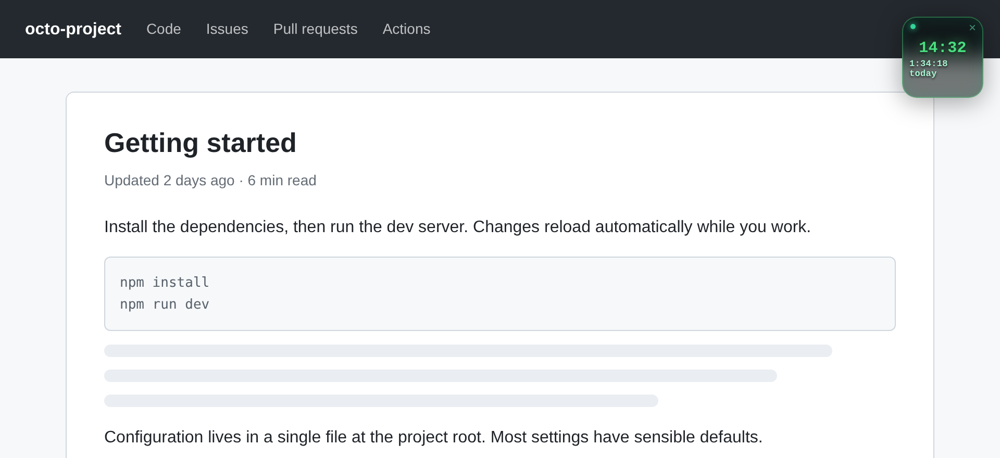
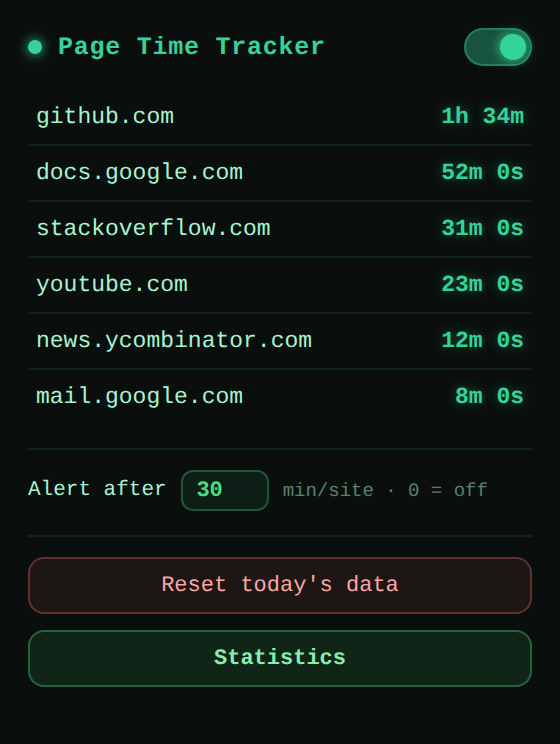
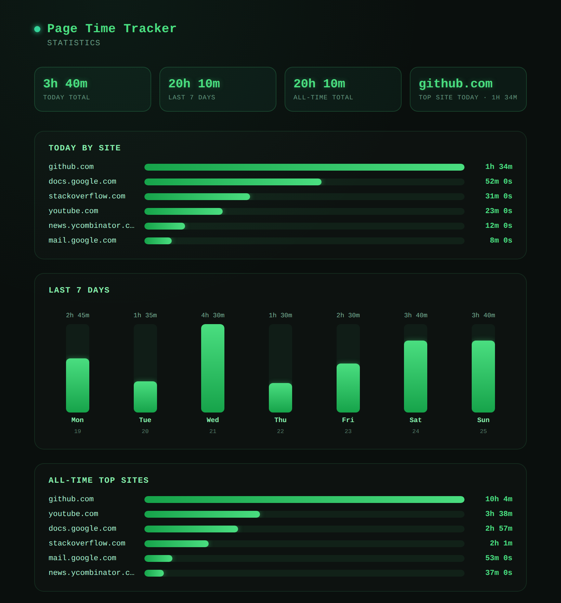

<div align="center">


# Page Time Tracker

**See exactly where your browsing time goes, without your data leaving the device.**

A small, always-visible timer on every page, daily per-site totals, limit alerts and a statistics dashboard, all stored locally in your browser.


[Features](#features) · [Installation](#installation) · [Permissions](#permissions) · [Privacy](#privacy) · [Publishing](docs/PUBLISHING.md)

<br />



</div>

---

## Features

| | |
|---|---|
| ⏱️ **Floating timer** | A compact, draggable widget showing time on the current visit and today's total for the site. It remembers where you put it. |
| 🎯 **Honest counting** | Time is counted only while the tab is visible *and* focused. Background tabs and minimised windows are ignored. |
| 🔔 **Daily limit alerts** | A native notification when any site passes your daily limit (default 30 minutes; set `0` to turn it off). |
| 📊 **Statistics dashboard** | Today, last 7 days, all-time totals and top sites, updating live. |
| 🔒 **Private by design** | No accounts, no servers, no analytics. Everything stays in your browser. |

## Screenshots

<table>
  <tr>
    <td width="34%" valign="top" align="center">
      <br />
      <sub><b>Toolbar popup</b>: today's ranking, tracking toggle, alert threshold</sub>
    </td>
    <td width="66%" valign="top" align="center">
      <br />
      <sub><b>Statistics</b>: totals, today by site, 7-day trend, all-time top sites</sub>
    </td>
  </tr>
</table>

## Installation

### Chrome Web Store

*Coming soon.*

### From source

1. Clone the repository:
   ```bash
   git clone https://github.com/Scube-27/page-time-tracker.git
   ```
2. Open `chrome://extensions` and turn on **Developer mode**.
3. Click **Load unpacked** and select the cloned folder.

It works in Google Chrome and Chromium-based browsers with Manifest V3 support, including Microsoft Edge, Brave and Opera.

## Usage

- **Widget:** drag it anywhere on the page. Click `×` to hide it on the current page, and hover over it to see the hostname.
- **Popup:** click the toolbar icon to switch tracking on or off, see today's ranking, set the alert threshold or reset today's data.
- **Statistics:** open it from the popup to see the full dashboard.

## Permissions

| Permission | Purpose |
|---|---|
| `storage` | Saves time history, settings and widget position on the device. |
| `notifications` | Shows the daily limit alert. |
| Content script on all sites | Displays the widget and counts time on the page you are viewing. |

The extension makes no network requests and runs no remote code.

## Privacy

Page Time Tracker records only the **hostname** of each site and the **number of seconds** spent on it each day. It stores that data in `chrome.storage.local`, and nothing is ever transmitted. History older than 90 days is deleted automatically. Uninstalling the extension removes everything.

See the full [Privacy Policy](PRIVACY.md).

## Publishing

Release and Chrome Web Store submission steps are in the [Publishing Guide](docs/PUBLISHING.md).
